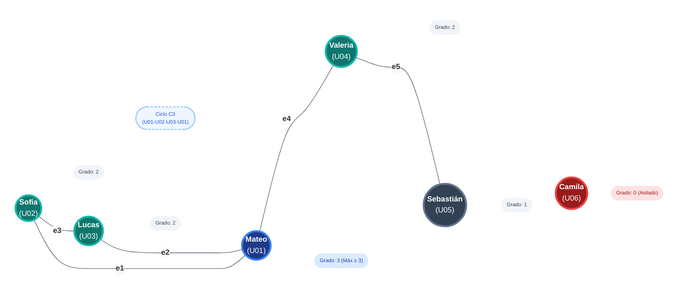

|# APE 4 · Fase 1: Grafos y Vértices — Red Social Original

**Universidad Técnica de Ambato**  
**Facultad de Ingeniería en Sistemas, Electrónica e Industrial**  
**Carrera de Software · Estructura de Datos (Tercero "B")**  

---

##  Datos Informativos
* **Estudiante:** Kleber Andrés Moyota Chávez
* **Grupo:** Grupo 4
* **Docente:** Ing. José Caiza, Mg.
* **Tema:** Requisitos, modelado conceptual y verificación de invariantes de una red social mediante grafos.

---

##  Descripción del Proyecto
Este repositorio contiene el diseño conceptual y la verificación de contratos para el reto de la **Fase 1 de la APE 4**. Se modela una red social original mediante un **grafo simple, no dirigido y no ponderado** $G = (V, E)$ compuesto exactamente por **6 usuarios (vértices)** y **5 relaciones de amistad (aristas)**, verificando el cumplimiento de invariantes topológicas y reglas de negocio.

---

##  Modelo Matemático del Grafo $G = (V, E)$

### 1. Conjunto de Vértices ($V$)
$V = \{U01, U02, U03, U04, U05, U06\}$

| ID | Usuario | Grado $g(v)$ | Vecinos Adyacentes | Rol Topológico |
| :---: | :--- | :---: | :--- | :--- |
| **U01** | Mateo | **3** | `{U02, U03, U04}` | Vértice de mayor grado ($\ge 3$) |
| **U02** | Sofía | **2** | `{U01, U03}` | Parte del ciclo $C_3$ |
| **U03** | Lucas | **2** | `{U01, U02}` | Parte del ciclo $C_3$ |
| **U04** | Valeria | **2** | `{U01, U05}` | Nodo puente hacia `U05` |
| **U05** | Sebastián | **1** | `{U04}` | Vértice hoja (extremo) |
| **U06** | Camila | **0** | `∅` (Vacío) | Usuario aislado (Grado $0$) |

### 2. Conjunto de Aristas ($E$)
$E = \{e_1, e_2, e_3, e_4, e_5\}$

* **$e_1 = \{U01, U02\}$:** Amistad recíproca entre Mateo y Sofía.
* **$e_2 = \{U01, U03\}$:** Amistad recíproca entre Mateo y Lucas.
* **$e_3 = \{U02, U03\}$:** Amistad recíproca entre Sofía y Lucas *(cierra el ciclo $U01 - U02 - U03 - U01$)*.
* **$e_4 = \{U01, U04\}$:** Amistad recíproca entre Mateo y Valeria.
* **$e_5 = \{U04, U05\}$:** Amistad recíproca entre Valeria y Sebastián.

> **Teorema del Apretón de Manos:**  
> $$\sum_{v \in V} g(v) = 3 + 2 + 2 + 2 + 1 + 0 = 10 = 2|E| \quad (2 \times 5 = 10)$$

---

## 📊 Representación Visual del Grafo
## 📊 Representación Visual del Grafo

    style U06 fill:#991B1B,stroke:#EF4444,stroke-width:3px,color:#FFFFFF
